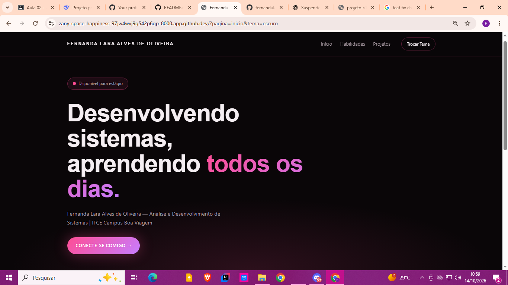

# Projeto V1 — Perfil do Estudante

**Fernanda Lara Alves de Oliveira** · ADS · IFCE Campus Boa Viagem
Programação Web I — Prof. Dr. Renato William Rodrigues de Souza

Site pessoal em **PHP puro** (sem frameworks). Tudo roda em um único
`index.php`, que decide o que mostrar pela query string da URL.

---

## Como rodar

```bash
cd projeto/v1
php -S localhost:8000 -d display_errors=1 -d output_buffering=0
```

Abra **http://localhost:8000**. Para parar: `Ctrl + C`.

---

## Telas

**Tema claro**


**Tema escuro**


---

## Rotas

| URL | Mostra | Status |
|---|---|---|
| `/` ou `/?pagina=inicio` | Apresentação pessoal | 200 |
| `/?pagina=habilidades` | Habilidades + total | 200 |
| `/?pagina=projetos` | Lista dos 3 projetos | 200 |
| `/?pagina=projeto&id=1` | Detalhes do projeto 1 | 200 |
| `/?pagina=projeto&id=99` | "Projeto não encontrado" | 404 |
| `/?pagina=xyz` | "Página não encontrada" | 404 |
| `/?tema=escuro` | Tema escuro gravado em cookie | 200 |
| `/?tema=claro` | Tema claro gravado em cookie | 200 |
| `/?formato=json` | Dados em JSON | 200 |

---
## Estrutura de arquivos

```
projeto/v1/
├── index.php          → aplicação completa (rotas, dados, HTML)
├── style.css          → visual, com os dois temas (claro e escuro)
├── foto-perfil.jpeg   → foto exibida na seção "Sobre mim"
├── README.md          → este documento
└── prints/
    ├── claro.png
    └── escuro.png
```

---

## Saídas do terminal

### Página que existe
```bash
curl.exe -i "http://localhost:8000/?pagina=inicio"
```
```
HTTP/1.1 200 OK
Content-Type: text/html; charset=UTF-8
<!DOCTYPE html>...
```
`200 OK` = sucesso. O corpo é o HTML da página inicial.

### Página inexistente (404)
```bash
curl.exe -i "http://localhost:8000/?pagina=xyz"
```
```
HTTP/1.1 404 Not Found
...
<h2>Página não encontrada</h2>
```
`404` vem de `http_response_code(404)`, chamado **antes** de qualquer HTML.

### Projeto inexistente (404)
```bash
curl.exe -i "http://localhost:8000/?pagina=projeto&id=99"
```
```
HTTP/1.1 404 Not Found
...
<h2>Projeto não encontrado</h2>
```
`isset($projetos[$id])` retorna `false` → 404.

### Troca de tema (cookie)
```bash
curl.exe -i "http://localhost:8000/?tema=escuro"
```
```
HTTP/1.1 200 OK
Set-Cookie: tema=escuro; Max-Age=2592000; HttpOnly; SameSite=Lax
...
<body class="tema-escuro">
```
Cookie válido por **30 dias**. Ele **não** aparece em `$_COOKIE` na mesma
requisição — só na próxima. Por isso a URL tem prioridade:
`$tema = $_GET['tema'] ?? $_COOKIE['tema'] ?? 'escuro';`

### Tema inválido
```bash
curl.exe -i "http://localhost:8000/?tema=<script>"
```
```
HTTP/1.1 200 OK
...
<body class="tema-escuro">
```
Valor fora de `claro`/`escuro` cai no padrão. Nada executa.

### API JSON
```bash
curl.exe -i "http://localhost:8000/?formato=json"
```
```
HTTP/1.1 200 OK
Content-Type: application/json; charset=utf-8

{ "perfil": { ... }, "projetos": { ... } }
```
`exit` logo após o `echo` impede que HTML vaze na resposta.

### Log do servidor
```
[Sat Oct 14 18:00:00 2026] 127.0.0.1:54321 [200]: GET /
[Sat Oct 14 18:00:10 2026] 127.0.0.1:54323 [404]: GET /?pagina=xyz
```
`[200]`/`[404]` é o status. O resto é IP, porta, método e caminho.

---

## Onde usei cada conceito

| Conceito | Onde |
|---|---|
| Arrays associativos | `$perfil`, `$projetos` no topo |
| `$_GET` | `pagina`, `id`, `tema`, `formato` |
| `$_COOKIE` | `$_COOKIE['tema'] ?? 'escuro'` |
| `setcookie()` | Bloco que grava o tema quando vem pela URL |
| `if / elseif / else` | Escolhe qual seção renderizar |
| `http_response_code()` | 404 para página/projeto inexistente |
| `header()` | `Content-Type: application/json` |
| `json_encode()` | Rota JSON (com `PRETTY_PRINT` + `UNESCAPED_UNICODE`) |
| `exit` | Encerra após o JSON |
| `htmlspecialchars()` | Função `e()` em toda saída |
| `count()` | Total de habilidades |
| `explode()` + `trim()` | Tags de tecnologia dos projetos |
| Sintaxe `if: endif;` | Nos blocos de HTML alternados |
| `date('Y')` | Ano no rodapé |

---

## Decisões e dificuldades

**Lógica no topo:** qualquer saída antes de `header()`/`setcookie()` gera
*"headers already sent"*. Por isso dados, tema, JSON e roteamento vêm
**antes** do `<!DOCTYPE html>`.

**Validar o tema:** o valor vem da URL e é controlado pelo usuário. Aceitar
só `claro`/`escuro` (allowlist) evita que algo como `?tema=<script>` seja
refletido no `<body>`.

**URL antes do cookie:** `setcookie()` grava na resposta, mas o cookie só
volta em `$_COOKIE` na **próxima** requisição. Se o cookie tivesse
prioridade, a troca de tema não funcionaria no primeiro clique.

**Mais difícil:** garantir que nenhum espaço em branco saísse antes dos
headers. Solução: um único bloco `<?php ... ?>` no topo, HTML só depois.

---

## Commits

```
feat(projeto-v1): adiciona dados do perfil e página inicial
feat(projeto-v1): adiciona páginas de habilidades e projetos
feat(projeto-v1): adiciona detalhes do projeto e página 404
feat(projeto-v1): adiciona tema claro e escuro com cookie
feat(projeto-v1): adiciona rota em JSON
style(projeto-v1): cria o visual com os dois temas
docs(projeto-v1): documenta rotas e saídas do terminal
```